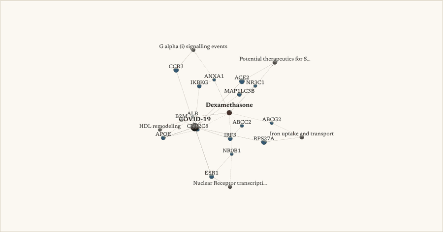
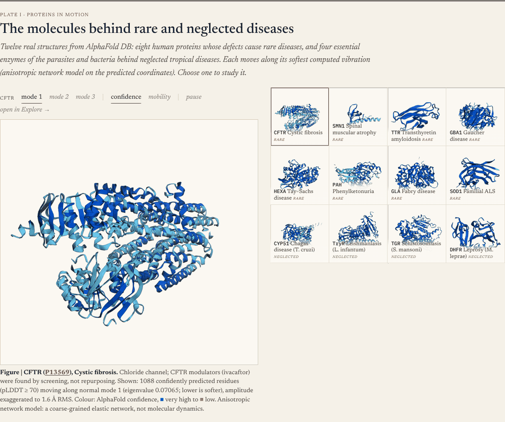
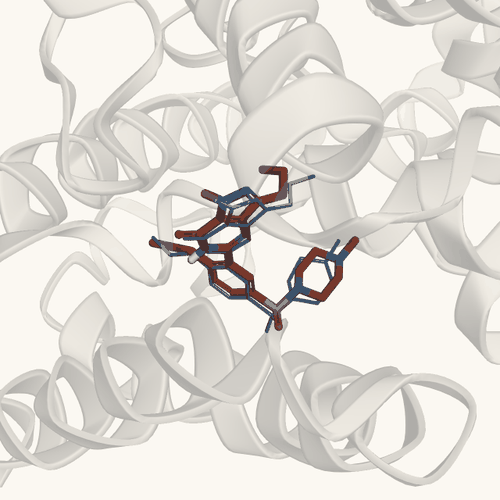
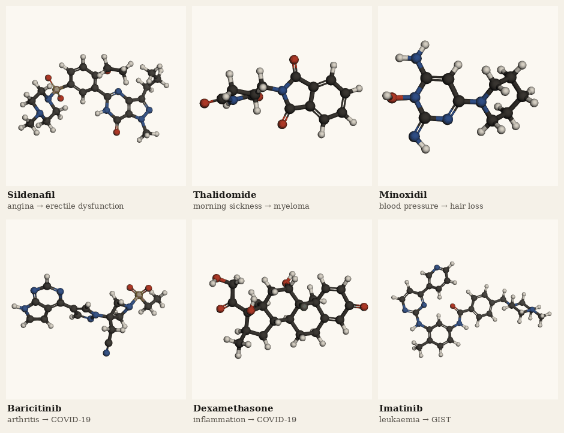
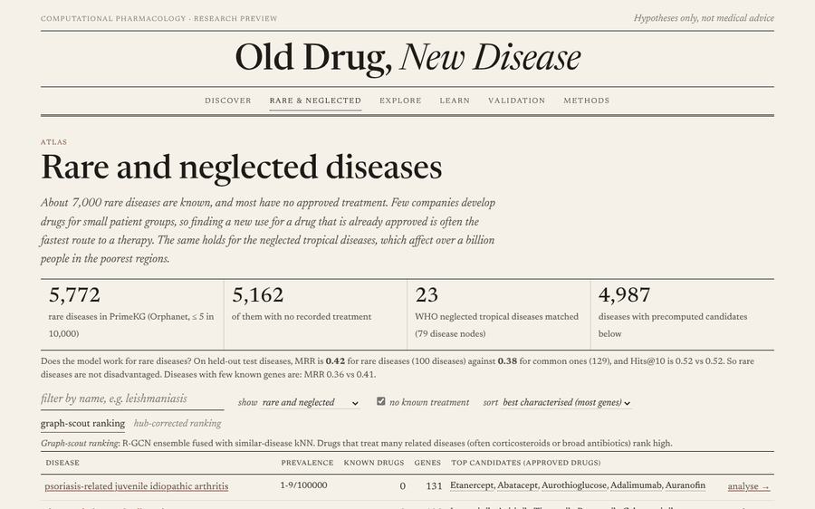
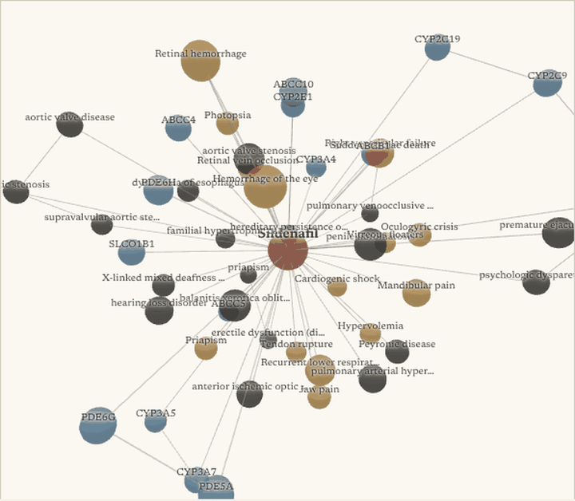
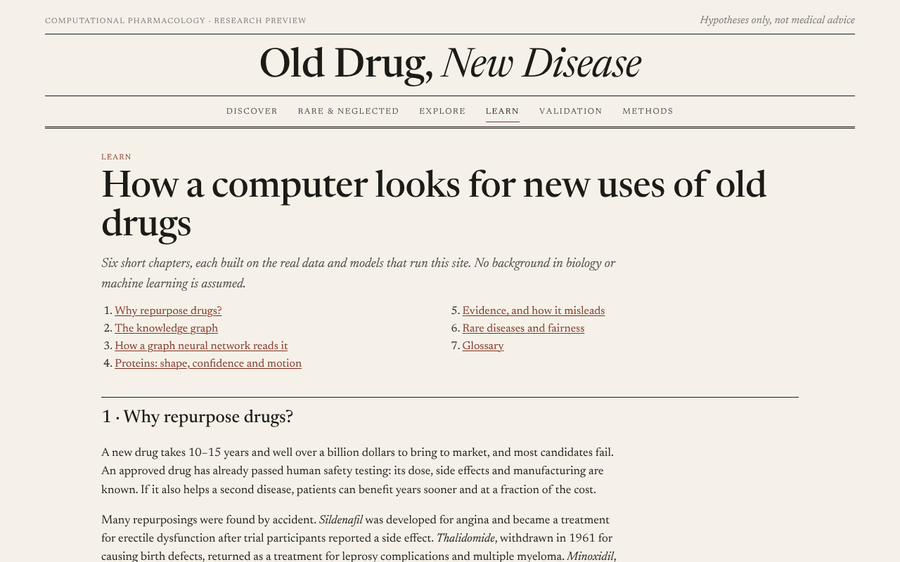

  

  <b>Type a disease. Get the approved drugs most likely to treat it, with the evidence for and against each one.</b> 
  A graph neural network over an 8-million-edge biomedical knowledge graph, seven evidence agents, real AlphaFold proteins in 3D and 4D,
  and a free atlas of candidates for <b>4,987 rare and neglected diseases</b>.

  
  
  
  
  
  
  
  

  <a href="#-see-it-work">Demo</a> ·
  <a href="#-proteins-in-3d-and-4d">3D &amp; 4D proteins</a> ·
  <a href="#-how-it-works">How it works</a> ·
  <a href="#-results">Results</a> ·
  <a href="#-rare--neglected-disease-atlas">Rare-disease atlas</a> ·
  <a href="#-getting-the-code"><b>Get the code</b></a> ·
  <a href="reports/VALIDATION.md">Validation report</a>

> [!IMPORTANT]
> ### 🔒 This repository does not contain the source code
> It is a public showcase of the project: what it does, how it works, and the results it measured.
> **The code, trained models and data pipeline are private. To get access, contact me:**
> 📸 DM me on Instagram [@r0han.git](https://www.instagram.com/r0han.git/), open an [issue on this repository](../../issues/new?title=Code%20access%20request), or message me through my GitHub profile, [@URK23CS7048Rohan](https://github.com/URK23CS7048Rohan).

---

## Why this exists

**More than 7,000 rare diseases are known, and about 95% of them have no approved treatment.** The people who have them are rarely a big enough market for a new drug.
Neglected tropical diseases affect over a billion people and get a sliver of research funding. Developing a new drug takes **10 to 15 years and over $1 billion**.

An **approved drug** has already passed human safety testing. If it also helps a second disease, that "repurposed" drug can reach patients in a fraction of the time.
This has worked famously by accident:

| Drug | Made for | Now also used for |
|---|---|---|
| Sildenafil | angina | erectile dysfunction, pulmonary hypertension |
| Thalidomide | morning sickness (withdrawn) | multiple myeloma, leprosy complications |
| Minoxidil | high blood pressure | hair loss |
| Baricitinib | rheumatoid arthritis | COVID-19 (found by an AI knowledge graph in 2020) |

**Old Drug, New Disease** searches for these connections on purpose. It tests every approved drug against a disease and shows *why* each candidate is ranked where it is.
It also says when the evidence is weak, so a researcher can decide what is worth a lab experiment.

> [!IMPORTANT]
> **Research use only.** Every output is a computational hypothesis that needs laboratory and clinical validation. Nothing here is medical advice.
> See the [model card](MODEL_CARD.md) for intended use, limits and measured performance.

---

## 🎬 See it work

  

A real, unedited run on <b>COVID-19</b>, a disease with no drug links in the graph. Its top candidates are systemic corticosteroids such as prednisolone and
<b>dexamethasone</b>, the class the WHO recommends for severe COVID-19 after the RECOVERY trial showed dexamethasone reduces deaths.

  

<b>Why dexamethasone for COVID-19?</b> The real mechanism paths the model found in PrimeKG: drug → target (NR3C1, the glucocorticoid receptor, and others) → pathways and disease genes → COVID-19.

<table>
  <tr>
    <td width="50%"> <b>Ranked candidates.</b> Each drug's score from every evidence agent, styled like a journal table.</td>
    <td width="50%"> <b>Why this drug?</b> Mechanism paths drug → target → pathway → disease gene → disease, as an interactive 3D graph.</td>
  </tr>
  <tr>
    <td width="50%"> <b>Docking.</b> The drug docked into its target's binding pocket with AutoDock Vina, compared against random decoy drugs.</td>
    <td width="50%"> <b>Safety and the Skeptic.</b> FDA adverse-event reports, boxed warnings and side effects. The Skeptic agent's objections are listed next to them.</td>
  </tr>
</table>

---

## 🧬 Proteins in 3D and 4D

Every protein in the app is a **real structure** from AlphaFold DB or the RCSB Protein Data Bank, not an illustration.
The home page goes one step further, into **4D**. Each protein moves along its own **normal modes**, the natural flexing motions computed from its coordinates
with an anisotropic network model. The colours show which parts move most.

  

<b>The app's home page, live.</b> Twelve real AlphaFold proteins behind rare and neglected diseases, all moving at once. Pick one to study it in detail.

  

<b>Rare and neglected-disease proteins in motion.</b> The softest <i>collective</i> normal mode of each AlphaFold model (Cα, pLDDT ≥ 70, 15 Å cutoff), exaggerated only as far as every backbone bond stays intact, coloured from rigid (blue) to most mobile (red). Stiff proteins move less, as they should.

  

<b>Targets of famous repurposed drugs, in motion:</b> PDE5A (sildenafil), cereblon (thalidomide), SUR2 (minoxidil), JAK1 (baricitinib), glucocorticoid receptor (dexamethasone) and TYK2.

<b>Gallery: 24 real protein structures</b> (click to collapse)

 

Coloured with the AlphaFold confidence scale: dark blue means very high confidence (pLDDT > 90), light blue confident, yellow low, orange very low.

<table>
  <tr>
    <td width="44%"></td>
    <td>
      <h3>Does the docking find the right pose?</h3>
      
Sildenafil docked into PDE5A by the Structure Agent (<b>red</b>), overlaid on the drug's real position in the crystal structure PDB 1TBF (<b>thin blue</b>).

      
Heavy-atom RMSD: <b>0.85 Å</b> over 33 atoms. Under 2 Å is the usual bar for a correct pose. Vina scores: sildenafil −9.1 kcal/mol, tadalafil −10.3 kcal/mol.

      
An honest note: this is the easy case, redocking into the drug's own co-crystal structure. Docking into AlphaFold models and fpocket-predicted pockets is less reliable, so the app only uses docking as a sanity filter against decoy drugs, never to predict affinity.

    </td>
  </tr>
</table>

  

<b>The drugs themselves.</b> Real 3D conformers from PubChem of six drugs that found a second use. Every candidate in the app has one.

---

## 🔬 How it works

<b>Every component and its real data source</b>

| Component | What it does | Real data source |
|---|---|---|
| **Graph Scout** | Heterogeneous R-GCN (PyTorch Geometric, 2 layers × 128 d, basis decomposition) + DistMult decoder, trained TxGNN-style with episodes on a disease-held-out split. A 3-seed ensemble is fused with a similar-disease kNN | PrimeKG, Harvard Dataverse doi:10.7910/DVN/IXA7BM |
| **Pre-trained features** | Each disease starts from a PubMedBERT embedding of its definition (treatment sentences removed and drug names masked, so it cannot leak answers); each drug from a Morgan fingerprint of its structure | MONDO/Orphanet definitions, PubChem |
| **Targets** | Disease → target associations, restricted to evidence that is independent of drugs (genetics, somatic, expression, pathways, animal models) | Open Targets Platform GraphQL |
| **Literature Agent** | PubMed co-mention search. A claim is kept only if its PMID resolves and its text names the drug | NCBI E-utilities |
| **Gene Agent** | Does the drug's L1000 profile reverse the disease's patient-vs-control expression signature? | GEO signatures (CREEDS via Enrichr) × LINCS L1000 (L1000CDS²) |
| **Structure Agent** | Binding site from the best co-crystal, else AlphaFold + fpocket. Vina 1.2 docking against 10 property-matched approved-drug decoys in the same box | UniProt, AlphaFold DB, RCSB PDB, PubChem 3D |
| **Safety Agent** | Adverse-event reports, boxed warnings, side effects, contraindications | openFDA, SIDER, PrimeKG |
| **Trial Agent** | Registered trials for the pair (switched off in validation to avoid leakage) | ClinicalTrials.gov v2 |
| **Skeptic + Judge** | Objections: hub bias, no mechanistic path, cautionary literature, signature mimicry, weak docking, contraindication. Warnings: a drug that pushes a target the wrong way (ChEMBL action vs. loss/gain-of-function genetics, OncoKB for cancers) and, for brain diseases, a drug unlikely to cross the blood-brain barrier. Judge: `S = Σ w_k z_k − λ_s·Safety − λ_c·Conflict`, with weights from logistic regression on validation diseases. Missing evidence is left out, never counted as negative | |
| **Explainer** | Hub-penalised paths drug → target → (PPI/pathway) → disease gene → disease | PrimeKG |
| **Web app** | FastAPI + vanilla JS, live agent log (SSE), 3Dmol.js and 3d-force-graph | |

**Unseen diseases work too.** Diseases have *no identity embedding*: the model sees a disease only through its neighbours in the graph and its description.
Type a disease that isn't in PrimeKG, and the app builds a new node from its Open Targets genes and scores it.

---

## 📊 Results

Measured on diseases the model never saw. The test set has **227 diseases (2,196 drug–disease pairs)** whose drug links were completely hidden during training.
Diseases are split in whole ontology groups, so no test disease has a parent, child or near-duplicate in training (a unit test checks this).
Each true drug is ranked against **all 2,755 approved drugs**. Brackets are 95% bootstrap confidence intervals. Full details: [`reports/VALIDATION.md`](reports/VALIDATION.md).

<table>
<tr><td width="58%">

| Model | MRR | Hits@1 | Hits@10 | Median rank |
|---|---|---|---|---|
| Random | 0.003 | 0.000 | 0.004 | 1,363 |
| TransE / RotatE (PyKEEN) | 0.040 / 0.038 | 0.014 / 0.009 | 0.089 / 0.099 | 382 / 378 |
| Network proximity | 0.058 | 0.041 | 0.079 | 727 |
| Popularity | 0.172 | 0.134 | 0.222 | 279 |
| Similar-disease kNN | 0.261 [0.19–0.33] | 0.222 | 0.315 | 97 |
| R-GCN, no pre-trained features | 0.252 | 0.209 | 0.341 | 106 |
| R-GCN + disease text & drug structure | 0.284 [0.23–0.34] | 0.226 | 0.390 | 27 |
| **Deployed hybrid** (+ kNN) | **0.319** [0.25–0.38] | **0.266** | **0.405** | 29 |

</td><td>

</td></tr>
</table>

**What the numbers mean.** For a disease the model has never seen, a correct drug is the model's **first pick about 1 time in 4**,
and is in its **top 10 about 4 times in 10**, out of 2,755 approved drugs. Random guessing gets 0.4%.

* 📐 **Statistically better, not just bigger.** Scored on the same diseases (paired bootstrap, 5,000 resamples), the deployed hybrid beats the
  kNN baseline by **+0.058 MRR (95% CI +0.036 to +0.082)** and **+9.1 points of Hits@10**; it was better in every resample.
  The pre-trained features alone add +0.037 MRR (+0.018 to +0.056).
* 🔁 **Rediscovery.** Held-out erectile dysfunction: the known drugs rank tadalafil **#1**, phentolamine **#2**, vardenafil **#5** and sildenafil **#8**.
  **Baricitinib → COVID-19**, a link *absent* from the graph, ranks **#20 of 2,755 (top 1%)**: the same idea BenevolentAI's knowledge graph proposed in 2020, later confirmed in trials.
  For COVID-19 itself the top candidates are systemic corticosteroids (prednisolone, methylprednisolone, dexamethasone), the class the WHO recommends for severe COVID-19.
  Misses are reported too: thalidomide → myeloma #207, minoxidil → hair loss #1,292 (an accidental side effect that leaves no trace in the graph).
* 🧪 **Real-world check.** For held-out diseases, **26.3%** of the model's top-10 *new* predictions already have a registered clinical trial for that disease,
  against **4.3%** for random approved drugs: about 6× more (95% CIs 19.5–34.0% vs 2.3–6.5%).
* ⚖️ **Strongest where it matters.** Rare diseases score **MRR 0.50 vs 0.25** for common ones (Hits@10 60% vs 33%).
  What hurts is data poverty: diseases with ≤ 10 known genes reach MRR 0.21, against 0.43 for the rest, and the app flags them as low-confidence.

> [!NOTE]
> **How the numbers were made honest.** Our own tests found a leak in the first split: 68 of 233 test diseases had a near-duplicate in training
> (*type 1 diabetes mellitus* / *IDDM 1*). We fixed the split and **retrained every model**. The kNN baseline, which copies the drugs of the most similar
> training disease, fell from 0.381 to 0.261; the old results are archived in [`reports/split_v1`](reports/split_v1).
> Protein-sequence features (ESM-2) were tested and made the model worse, so they are not used.
> A drug-direction check (inhibitor vs. loss-of-function genetics) could not be validated with today's public data, so it is shown as a warning only.

---

## 🗺️ Rare & neglected disease atlas

* **5,772 rare diseases** (Orphanet prevalence ≤ 5 in 10,000), of which **5,162 have no recorded treatment**.
  There are also **79 disease nodes** across **23 WHO neglected tropical diseases** (Chagas, leishmaniasis, schistosomiasis, leprosy and others).
* Candidates are **precomputed for 4,987 diseases** for the app.
* **Hub-corrected rankings.** Corticosteroids land in the top 10 for 52% of rare diseases, because they're proposed for almost everything.
  A second ranking subtracts each drug's average score, so drugs *specific* to the disease rise. Diseases with fewer than three known genes are flagged as low-confidence.

## 🎓 Explore and learn

The app is also built for students and curious people:

* **Explore.** Every one of PrimeKG's **129,375 nodes** has its own page with its connections and a 3D neighbourhood map.
  Genes show their AlphaFold structure in motion, and drugs show a 3D molecule. Links are shareable (`/#/node/<id>`).
* **Learn.** Seven illustrated chapters that run on the live data:
  1. why repurpose;
  2. what a knowledge graph is;
  3. how a GNN reads it;
  4. protein confidence and motion;
  5. how evidence misleads (hub bias, literature leakage, FAERS reporting bias);
  6. fairness for rare diseases;
  7. a glossary.

  

<b>Sildenafil in the knowledge graph.</b> Its real neighbours in PrimeKG: its target PDE5A, the liver enzymes that break it down,
the diseases it treats (erectile dysfunction, pulmonary arterial hypertension) and its side effects. Every one of the 129,375 nodes has a map like this.

<table>
  <tr>
    <td width="33%"></td>
    <td width="33%"></td>
    <td width="33%"></td>
  </tr>
</table>

  

<b>Learn, running on the live data:</b> what is in the knowledge graph, how the GNN reads it, how evidence can mislead, and whether the model is fair to rare diseases.

---

## 🔒 Getting the code

**The source code is not in this repository.** The code, trained models, precomputed rare-disease atlas and full pipeline are kept private.

**Want the code, a live demo or a collaboration?** Contact me:

* 📸 **Instagram:** [@r0han.git](https://www.instagram.com/r0han.git/)
* 💬 **GitHub:** open an [issue](../../issues/new?title=Code%20access%20request) or message me through my profile, [@URK23CS7048Rohan](https://github.com/URK23CS7048Rohan)
 Tell me who you are and what you'd like to use it for.

**Built with:** Python · PyTorch Geometric · PyKEEN · RDKit · AutoDock Vina · fpocket · FastAPI · 3Dmol.js · 3d-force-graph.
**Data:** PrimeKG, Open Targets, PubMed, LINCS L1000, GEO, AlphaFold DB, RCSB PDB, PubChem, openFDA, SIDER, ClinicalTrials.gov, Orphanet.

## 🧭 How it compares

| | Disease-held-out evaluation | Rare / NTD focus | Multi-agent evidence + Skeptic | Open source | Interactive 3D/4D app |
|---|:-:|:-:|:-:|:-:|:-:|
| **Old Drug, New Disease** | ✅ | ✅ | ✅ | on request | ✅ |
| TxGNN (Huang et al., *Nat. Med.* 2024) | ✅ | ✅ | – | ✅ | explainer only |
| Every Cure (MATRIX) | – | ✅ | – | partly | – |
| Hetionet / Project Rephetio | – | – | – | ✅ | – |
| Connectivity Map (L1000) | – | – | signatures only | ✅ | – |
| BenevolentAI, Healx | not public | Healx: ✅ | not public | – | – |

This project builds on their ideas, with PrimeKG and TxGNN-style training at its core. What it adds is the agent layer, including an agent built to argue *against* each candidate.
It also adds honest baselines, a public atlas for rare diseases, and an app made for exploring and learning.

## ⚠️ Caveats

* **The split.** PrimeKG has no timestamps, so a strict time-split (training on the past, testing on the future) isn't possible. Holding out whole ontology groups is the closest substitute.
* **Data-poor diseases.** With few known genes, accuracy drops sharply (MRR 0.21 vs 0.43); treat those predictions as low-confidence.
* **Direction of effect** is not modelled by the graph. A warning exists, but public loss/gain-of-function data covers too few drug targets to validate it.
* **Blood-brain barrier** penetration is estimated from chemical structure, not measured.
* **Docking** uses a rigid receptor, Vina scoring and about 20 runs per disease. It is a sanity filter, not affinity prediction.
* **FAERS** counts reflect how often events are *reported*, not how often they happen.
* **Literature and trials** mostly rediscover what is already known, so they are switched off or reported separately in validation.

## 📚 Citation

If this is useful in your work, please cite it (GitHub's **"Cite this repository"** button uses [`CITATION.cff`](CITATION.cff)) and the resources it builds on:

Chandak, Huang & Zitnik, *Building a knowledge graph to enable precision medicine*, Sci. Data 2023 (PrimeKG) ·
Huang et al., *A foundation model for clinician-centered drug repurposing*, Nat. Med. 2024 (TxGNN) ·
Schlichtkrull et al., *Modeling relational data with graph convolutional networks*, ESWC 2018 ·
Subramanian et al., *A next generation Connectivity Map: L1000*, Cell 2017 · Duan et al., *L1000CDS²*, NPJ Syst. Biol. Appl. 2016 ·
Jumper et al., AlphaFold, Nature 2021; Varadi et al., AlphaFold DB, NAR 2024 · Eberhardt et al., *AutoDock Vina 1.2.0*, JCIM 2021 ·
Le Guilloux et al., fpocket, BMC Bioinformatics 2009 · Ochoa et al., Open Targets Platform, NAR 2023 · Kuhn et al., SIDER 4.1, NAR 2016 ·
Wang et al., CREEDS, Nat. Commun. 2016 · Guney et al., *Network-based in silico drug efficacy screening*, Nat. Commun. 2016 ·
Bahar et al., *Anisotropic network model*, Biophys. J. 2001.

## License

© 2026 Rohan. All rights reserved: see [LICENSE](LICENSE). Data and structures shown belong to their sources and keep their own licences (PrimeKG CC BY 4.0, AlphaFold DB CC BY 4.0, RCSB PDB, openFDA, Orphanet).

---

  <b>If this project helped you learn something or gave you an idea, please give it a ⭐.</b> 
  It helps other students and researchers working on rare diseases find it.

