

  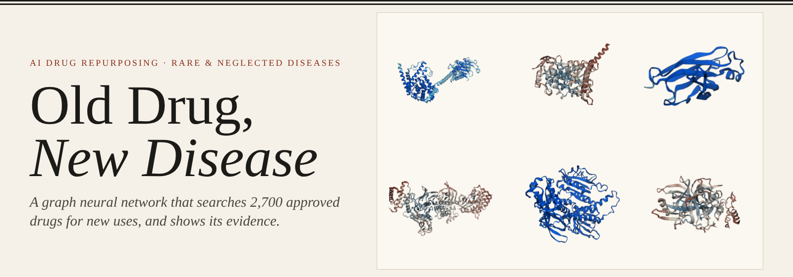

  <b>Type a disease. Get the approved drugs most likely to treat it, with the evidence for and against each one.</b> 
  A graph neural network over an 8-million-edge biomedical knowledge graph, seven evidence agents, real AlphaFold proteins in 3D and 4D,
  and a free atlas of candidates for <b>4,987 rare and neglected diseases</b>.

  
  
  
  
  
  
  
  

  <a href="#-see-it-work">Demo</a> ·
  <a href="#-proteins-in-3d-and-4d">3D &amp; 4D proteins</a> ·
  <a href="#-how-it-works">How it works</a> ·
  <a href="#-results">Results</a> ·
  <a href="#-rare--neglected-disease-atlas">Rare-disease atlas</a> ·
  <a href="#-getting-the-code"><b>Get the code</b></a> ·
  <a href="reports/VALIDATION.md">Validation report</a>

> [!IMPORTANT]
> ### 🔒 This repository does not contain the source code
> It is a public showcase of the project: what it does, how it works, and the results it measured.
> **The code, trained models and data pipeline are private. To get access, contact me:**
> open an [issue on this repository](../../issues/new?title=Code%20access%20request) or message me through my GitHub profile, [@URK23CS7048Rohan](https://github.com/URK23CS7048Rohan).

---

## Why this exists

**More than 7,000 rare diseases are known, and about 95% of them have no approved treatment.** The people who have them are rarely a big enough market for a new drug.
Neglected tropical diseases affect over a billion people and get a sliver of research funding. Developing a new drug takes **10 to 15 years and over $1 billion**.

An **approved drug** has already passed human safety testing. If it also helps a second disease, that "repurposed" drug can reach patients in a fraction of the time.
This has worked famously by accident:

| Drug | Made for | Now also used for |
|---|---|---|
| Sildenafil | angina | erectile dysfunction, pulmonary hypertension |
| Thalidomide | morning sickness (withdrawn) | multiple myeloma, leprosy complications |
| Minoxidil | high blood pressure | hair loss |
| Baricitinib | rheumatoid arthritis | COVID-19 (found by an AI knowledge graph in 2020) |

**Old Drug, New Disease** searches for these connections on purpose. It tests every approved drug against a disease and shows *why* each candidate is ranked where it is.
It also says when the evidence is weak, so a researcher can decide what is worth a lab experiment.

> [!IMPORTANT]
> **Research use only.** Every output is a computational hypothesis that needs laboratory and clinical validation. Nothing here is medical advice.

---

## 🎬 See it work

  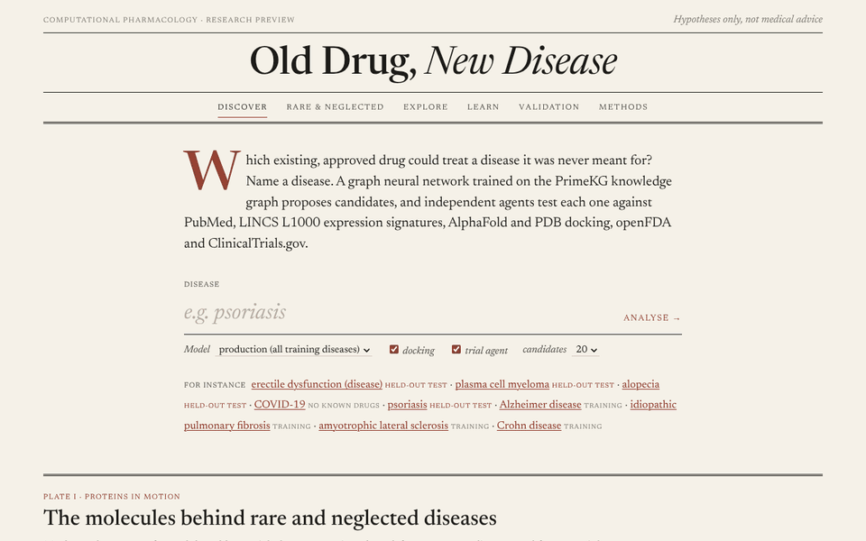

A real, unedited run on <b>COVID-19</b>, a disease whose drug links the model never saw in training. Its top candidate is <b>dexamethasone</b>,
the drug the RECOVERY trial showed reduces COVID-19 deaths.

<table>
  <tr>
    <td width="50%">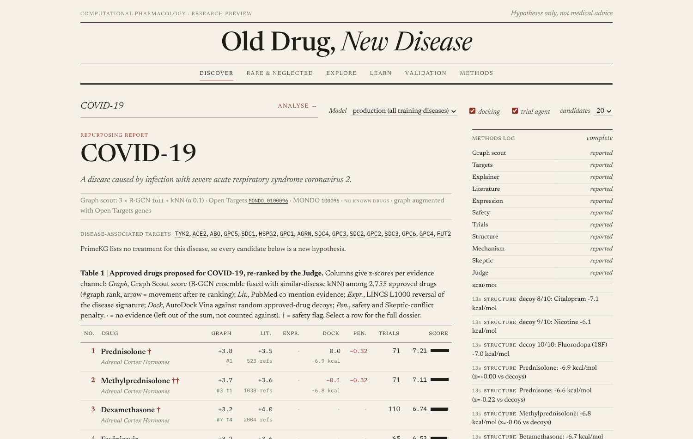 <b>Ranked candidates.</b> Each drug's score from every evidence agent, styled like a journal table.</td>
    <td width="50%">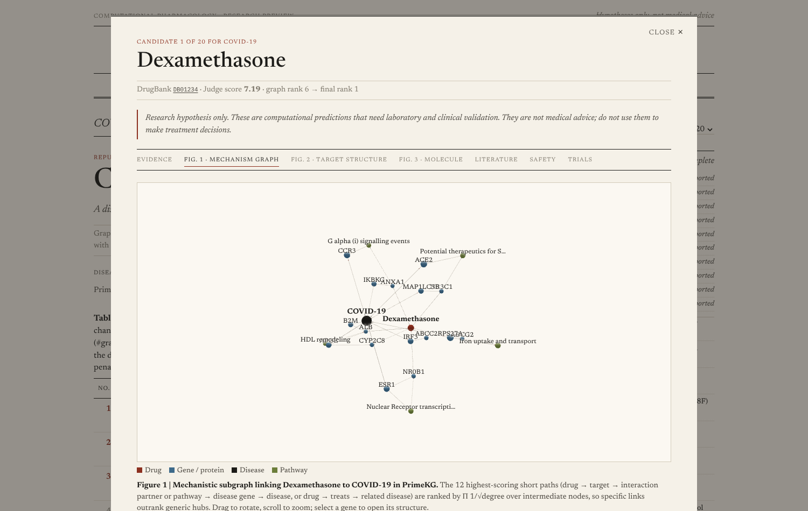 <b>Why this drug?</b> Mechanism paths drug → target → pathway → disease gene → disease, as an interactive 3D graph.</td>
  </tr>
  <tr>
    <td width="50%">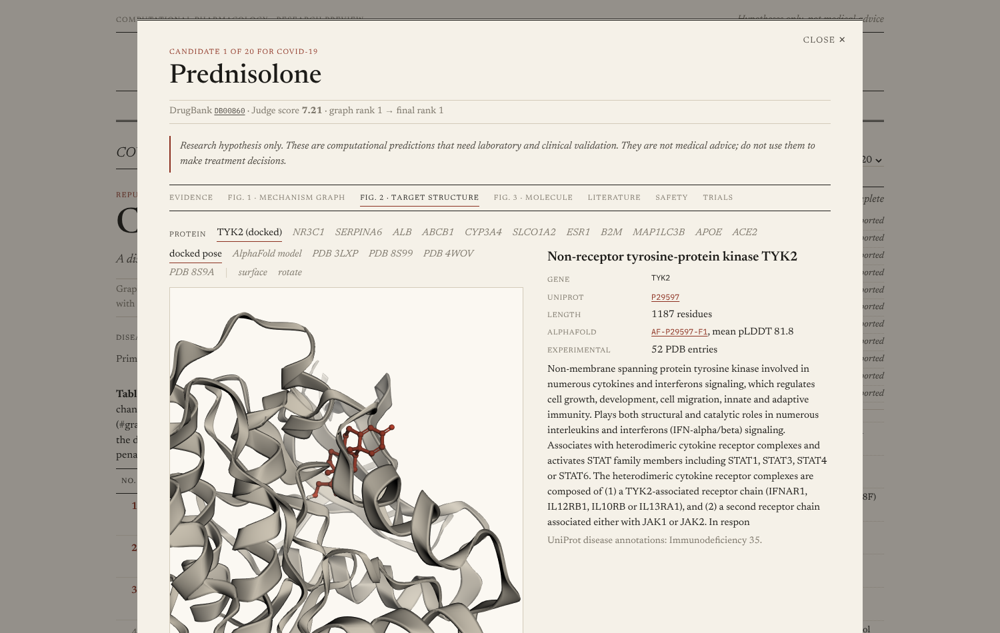 <b>Docking.</b> The drug docked into its target's binding pocket with AutoDock Vina, compared against random decoy drugs.</td>
    <td width="50%">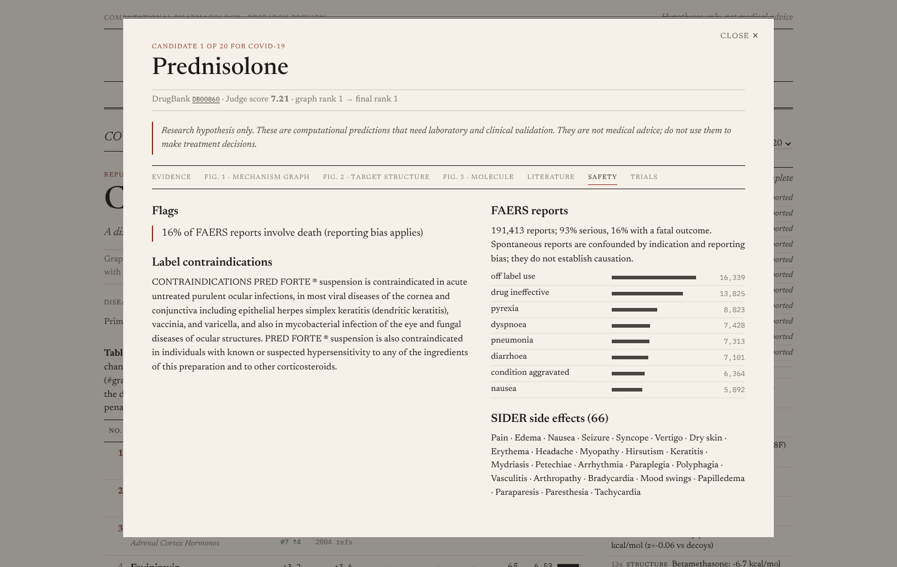 <b>Safety and the Skeptic.</b> FDA adverse-event reports, boxed warnings and side effects. The Skeptic agent's objections are listed next to them.</td>
  </tr>
</table>

---

## 🧬 Proteins in 3D and 4D

Every protein in the app is a **real structure** from AlphaFold DB or the RCSB Protein Data Bank, not an illustration.
The home page goes one step further, into **4D**. Each protein moves along its own **normal modes**, the natural flexing motions computed from its coordinates
with an anisotropic network model. The colours show which parts move most.

  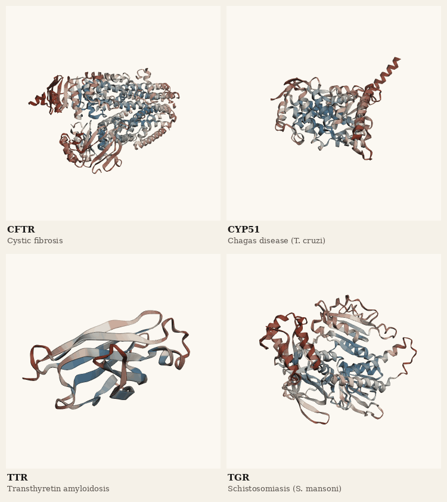

<b>Rare and neglected-disease proteins in motion.</b> Normal modes from each AlphaFold model (Cα, pLDDT ≥ 70, 15 Å cutoff), coloured from rigid (blue) to most mobile (red).

  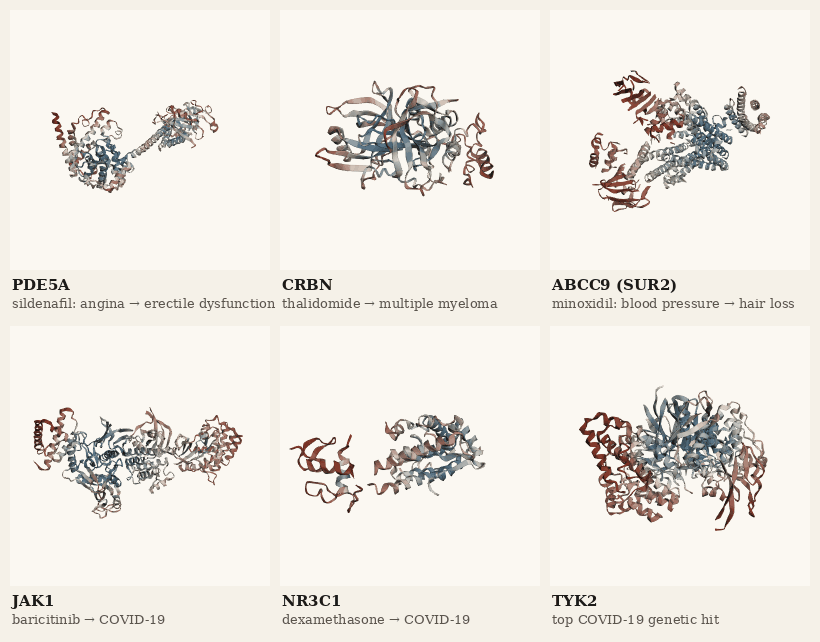

<b>Targets of famous repurposed drugs, in motion:</b> PDE5A (sildenafil), cereblon (thalidomide), SUR2 (minoxidil), JAK1 (baricitinib), glucocorticoid receptor (dexamethasone) and TYK2.

<b>Gallery: 24 real protein structures</b> (click to collapse)

 

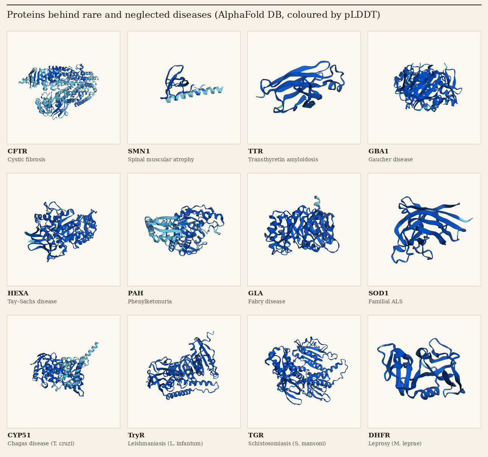

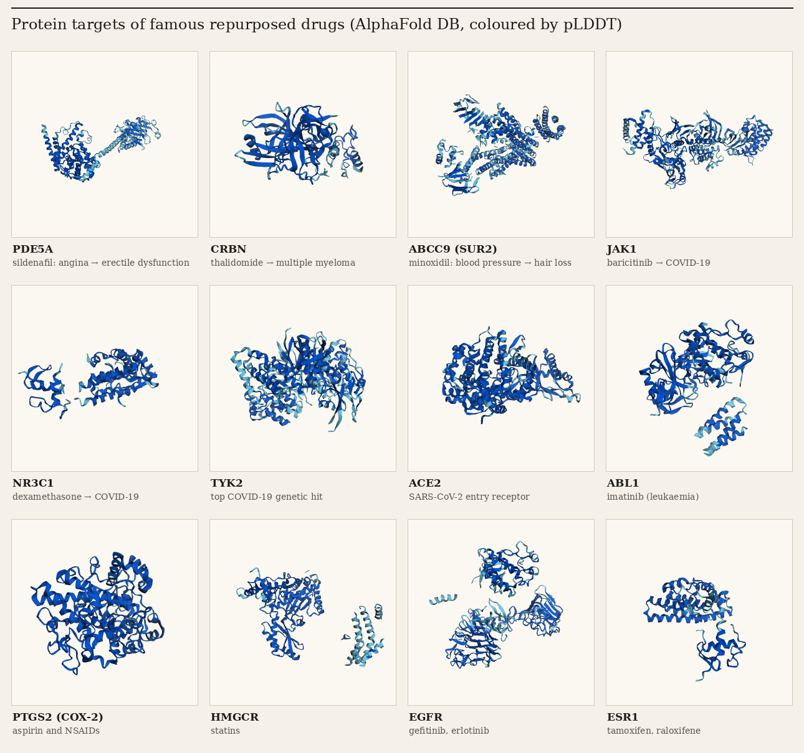

Coloured with the AlphaFold confidence scale: dark blue means very high confidence (pLDDT > 90), light blue confident, yellow low, orange very low.

<table>
  <tr>
    <td width="44%">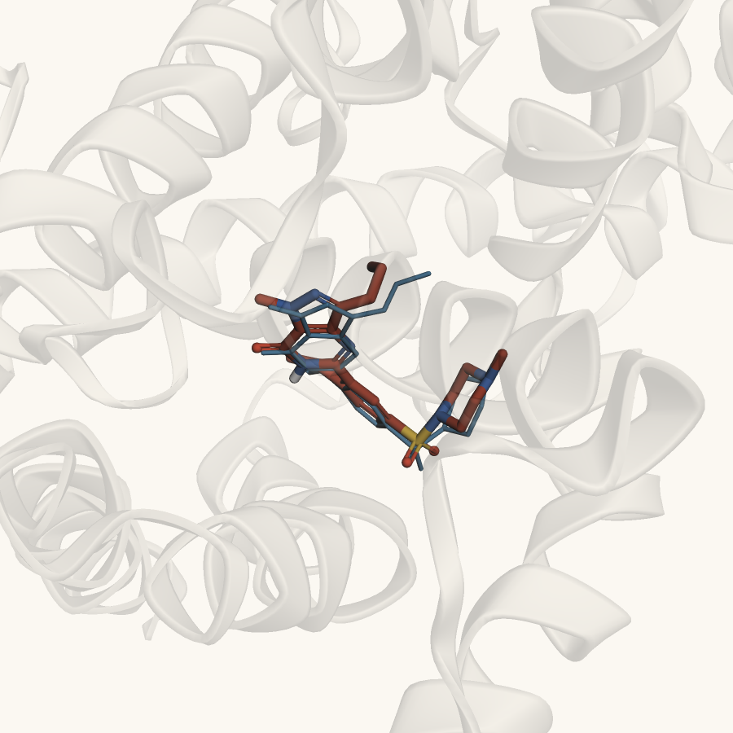</td>
    <td>
      <h3>Does the docking find the right pose?</h3>
      
Sildenafil docked into PDE5A by the Structure Agent (<b>red</b>), overlaid on the drug's real position in the crystal structure PDB 1TBF (<b>thin blue</b>).

      
Heavy-atom RMSD: <b>0.85 Å</b> over 33 atoms. Under 2 Å is the usual bar for a correct pose. Vina scores: sildenafil −9.1 kcal/mol, tadalafil −10.3 kcal/mol.

      
An honest note: this is the easy case, redocking into the drug's own co-crystal structure. Docking into AlphaFold models and fpocket-predicted pockets is less reliable, so the app only uses docking as a sanity filter against decoy drugs, never to predict affinity.

    </td>
  </tr>
</table>

---

## 🔬 How it works

```mermaid
flowchart LR
    Q([Disease name]) --> GS
    subgraph KG [PrimeKG knowledge graph · 129,375 nodes · 8.1 M edges]
      GS[Graph Scout<br/>R-GCN ensemble + similar-disease kNN]
    end
    GS -->|top candidates| A
    subgraph A [Evidence agents]
      direction TB
      L[Literature<br/>PubMed, PMID-verified]
      G[Gene<br/>GEO signature × L1000 reversal]
      S[Structure<br/>AlphaFold/PDB + Vina vs decoys]
      F[Safety<br/>FAERS · FDA labels · SIDER]
      T[Trials<br/>ClinicalTrials.gov]
    end
    A --> SK[Skeptic<br/>hub bias · conflicts · weak evidence]
    SK --> J[Judge<br/>weights fitted on validation diseases]
    J --> R([Ranked, explained candidates])
```

<b>Every component and its real data source</b>

| Component | What it does | Real data source |
|---|---|---|
| **Graph Scout** | Heterogeneous R-GCN (PyTorch Geometric, 2 layers × 128 d, basis decomposition) + DistMult decoder, trained TxGNN-style with episodes on a disease-held-out split. A 3-seed ensemble is fused with a similar-disease kNN | PrimeKG, Harvard Dataverse doi:10.7910/DVN/IXA7BM |
| **Targets** | Disease → target associations, restricted to evidence that is independent of drugs (genetics, somatic, expression, pathways, animal models) | Open Targets Platform GraphQL |
| **Literature Agent** | PubMed co-mention search. A claim is kept only if its PMID resolves and its text names the drug | NCBI E-utilities |
| **Gene Agent** | Does the drug's L1000 profile reverse the disease's patient-vs-control expression signature? | GEO signatures (CREEDS via Enrichr) × LINCS L1000 (L1000CDS²) |
| **Structure Agent** | Binding site from the best co-crystal, else AlphaFold + fpocket. Vina 1.2 docking against 10 property-matched approved-drug decoys in the same box | UniProt, AlphaFold DB, RCSB PDB, PubChem 3D |
| **Safety Agent** | Adverse-event reports, boxed warnings, side effects, contraindications | openFDA, SIDER, PrimeKG |
| **Trial Agent** | Registered trials for the pair (switched off in validation to avoid leakage) | ClinicalTrials.gov v2 |
| **Skeptic + Judge** | Objections: hub bias, no mechanistic path, cautionary literature, signature mimicry, weak docking, contraindication. Judge: `S = Σ w_k z_k − λ_s·Safety − λ_c·Conflict`, with weights from logistic regression on validation diseases. Missing evidence is left out, never counted as negative | |
| **Explainer** | Hub-penalised paths drug → target → (PPI/pathway) → disease gene → disease | PrimeKG |
| **Web app** | FastAPI + vanilla JS, live agent log (SSE), 3Dmol.js and 3d-force-graph | |

**Unseen diseases work too.** Diseases have *no identity embedding*: the model sees a disease only through its neighbours in the graph.
Type a disease that isn't in PrimeKG, and the app builds a new node from its Open Targets genes and scores it.

---

## 📊 Results

Measured, not estimated. The test set has **229 diseases (2,098 drug–disease pairs)** whose drug links were completely hidden during training.
Their parent, child and sibling diseases in the ontology were hidden with them, so subtypes can't leak answers.
Each true drug is ranked against **all 2,755 approved drugs**. Brackets are 95% bootstrap confidence intervals. Full details: [`reports/VALIDATION.md`](reports/VALIDATION.md).

<table>
<tr><td width="56%">

| Model | MRR | Hits@1 | Hits@10 | Median rank |
|---|---|---|---|---|
| Random | 0.004 | 0.000 | 0.005 | 1400 |
| Popularity | 0.135 | 0.101 | 0.175 | 291 |
| TransE / RotatE | 0.051 / 0.031 | 0.027 / 0.008 | 0.092 / 0.070 | 379 / 304 |
| Similar-disease kNN | 0.381 | 0.330 | 0.472 | 13 |
| R-GCN (single seed) | 0.292 ± 0.001 | 0.232 | 0.418 | – |
| R-GCN 3-seed ensemble | 0.349 | 0.291 | 0.472 | 13 |
| **Hybrid Graph Scout** | **0.393** [0.32–0.47] | **0.335** | **0.517** | **10** |

</td><td>

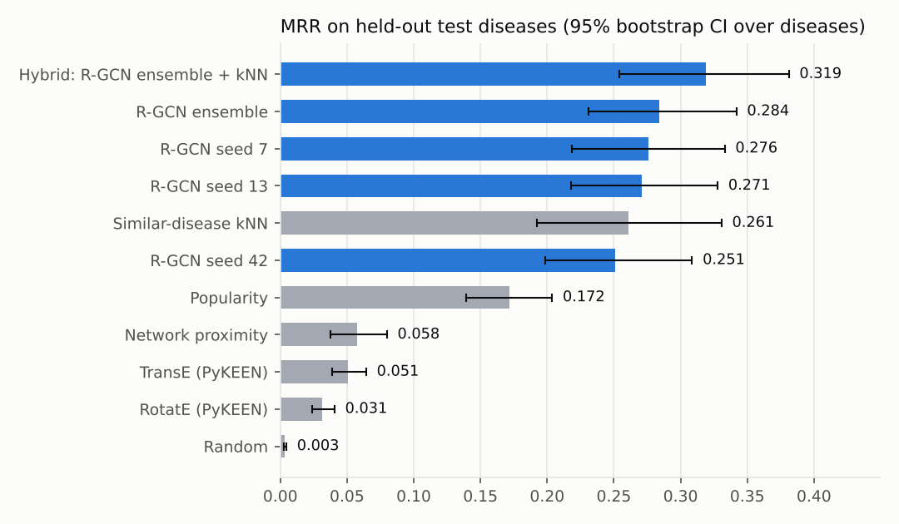

</td></tr>
</table>

**What the numbers mean.** For a disease the model has never seen, a correct drug is the model's **first pick 1 time in 3**,
and is in its **top 10 about half the time**, out of 2,755 approved drugs. Random guessing gets 0.5%.

* 🔁 **Rediscovery.** Held-out erectile dysfunction: the app ranks the known drugs phentolamine **#1**, tadalafil **#3**, vardenafil **#5** and sildenafil **#10**.
  COVID-19, which has no drugs in PrimeKG: **dexamethasone #1**.
  Baricitinib → COVID-19, a link *absent* from the graph, lands in the top 10% (#282) but is not a hit.
  Minoxidil → hair loss is a clear miss (#1,173). Hair growth was an accidental side effect that leaves no trace in the graph.
* 🧪 **Real-world check.** For held-out diseases, **27.6%** of the model's top-10 *new* predictions already have a registered clinical trial for that disease.
  Random approved drugs score **7.8%**. 95% CIs: 20.9–34.4% vs 5.2–11.3%.
* ⚖️ **Fair to rare diseases.** On test diseases, accuracy for rare diseases is not lower than for common ones (MRR 0.42 vs 0.38; Hits@10 0.52 vs 0.52).
  What does hurt is how little is known: diseases with ≤ 10 known genes reach MRR 0.36, against 0.41 for the rest.

> [!NOTE]
> **Honest reading.** A single R-GCN does *not* beat the simple similar-disease kNN baseline. The seed ensemble only matches it on Hits@10.
> The deployed hybrid is the best model, but its margin over kNN sits within the confidence intervals.
> The first version of the GNN lost outright, and that run is kept in the report.
> Literature evidence partly rediscovers what is already published, so it is reported separately.

---

## 🗺️ Rare & neglected disease atlas

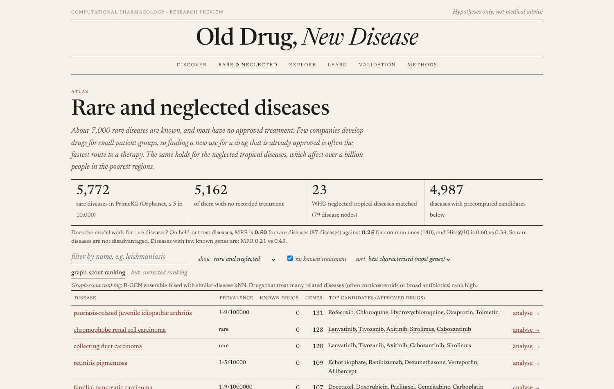

* **5,772 rare diseases** (Orphanet prevalence ≤ 5 in 10,000), of which **5,162 have no recorded treatment**.
  There are also **79 disease nodes** across **23 WHO neglected tropical diseases** (Chagas, leishmaniasis, schistosomiasis, leprosy and others).
* Candidates are **precomputed for 4,987 diseases** for the app.
* **Hub-corrected rankings.** Corticosteroids land in the top 10 for 52% of rare diseases, because they're proposed for almost everything.
  A second ranking subtracts each drug's average score, so drugs *specific* to the disease rise. Diseases with fewer than three known genes are flagged as low-confidence.

## 🎓 Explore and learn

The app is also built for students and curious people:

* **Explore.** Every one of PrimeKG's **129,375 nodes** has its own page with its connections and a 3D neighbourhood map.
  Genes show their AlphaFold structure in motion, and drugs show a 3D molecule. Links are shareable (`/#/node/<id>`).
* **Learn.** Seven illustrated chapters that run on the live data:
  1. why repurpose;
  2. what a knowledge graph is;
  3. how a GNN reads it;
  4. protein confidence and motion;
  5. how evidence misleads (hub bias, literature leakage, FAERS reporting bias);
  6. fairness for rare diseases;
  7. a glossary.

<table>
  <tr>
    <td width="33%">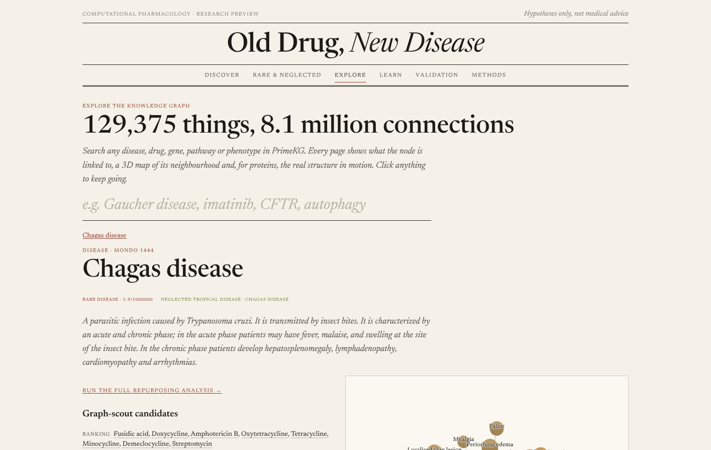</td>
    <td width="33%">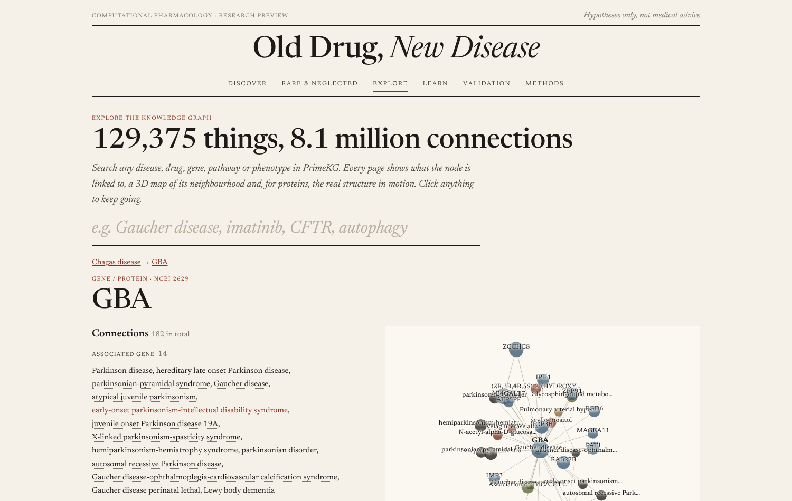</td>
    <td width="33%">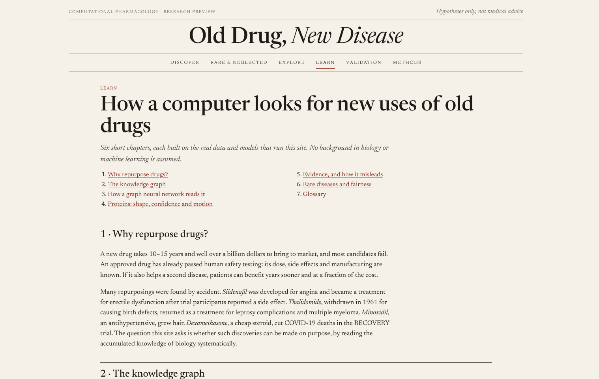</td>
  </tr>
</table>

---

## 🔒 Getting the code

**The source code is not in this repository.** The code, trained models, precomputed rare-disease atlas and full pipeline are kept private.

**Want the code, a live demo or a collaboration?** Contact me by opening an [issue](../../issues/new?title=Code%20access%20request)
or through my GitHub profile, [@URK23CS7048Rohan](https://github.com/URK23CS7048Rohan). Tell me who you are and what you'd like to use it for.

**Built with:** Python · PyTorch Geometric · PyKEEN · RDKit · AutoDock Vina · fpocket · FastAPI · 3Dmol.js · 3d-force-graph.
**Data:** PrimeKG, Open Targets, PubMed, LINCS L1000, GEO, AlphaFold DB, RCSB PDB, PubChem, openFDA, SIDER, ClinicalTrials.gov, Orphanet.

## 🧭 How it compares

| | Disease-held-out evaluation | Rare / NTD focus | Multi-agent evidence + Skeptic | Open source | Interactive 3D/4D app |
|---|:-:|:-:|:-:|:-:|:-:|
| **Old Drug, New Disease** | ✅ | ✅ | ✅ | on request | ✅ |
| TxGNN (Huang et al., *Nat. Med.* 2024) | ✅ | ✅ | – | ✅ | explainer only |
| Every Cure (MATRIX) | – | ✅ | – | partly | – |
| Hetionet / Project Rephetio | – | – | – | ✅ | – |
| Connectivity Map (L1000) | – | – | signatures only | ✅ | – |
| BenevolentAI, Healx | not public | Healx: ✅ | not public | – | – |

This project builds on their ideas, with PrimeKG and TxGNN-style training at its core. What it adds is the agent layer, including an agent built to argue *against* each candidate.
It also adds honest baselines, a public atlas for rare diseases, and an app made for exploring and learning.

## ⚠️ Caveats

* **The split.** PrimeKG has no timestamps, so a strict time-split (training on the past, testing on the future) isn't possible. Ontology-aware disease hold-out is the closest substitute.
* **Docking** uses a rigid receptor, Vina scoring and about 20 runs per disease. It is a sanity filter, not affinity prediction.
* **FAERS** counts reflect how often events are *reported*, not how often they happen.
* **Literature and trials** mostly rediscover what is already known, so they are switched off or reported separately in validation.

## 📚 Citation

If this is useful in your work, please cite it (GitHub's **"Cite this repository"** button uses [`CITATION.cff`](CITATION.cff)) and the resources it builds on:

Chandak, Huang & Zitnik, *Building a knowledge graph to enable precision medicine*, Sci. Data 2023 (PrimeKG) ·
Huang et al., *A foundation model for clinician-centered drug repurposing*, Nat. Med. 2024 (TxGNN) ·
Schlichtkrull et al., *Modeling relational data with graph convolutional networks*, ESWC 2018 ·
Subramanian et al., *A next generation Connectivity Map: L1000*, Cell 2017 · Duan et al., *L1000CDS²*, NPJ Syst. Biol. Appl. 2016 ·
Jumper et al., AlphaFold, Nature 2021; Varadi et al., AlphaFold DB, NAR 2024 · Eberhardt et al., *AutoDock Vina 1.2.0*, JCIM 2021 ·
Le Guilloux et al., fpocket, BMC Bioinformatics 2009 · Ochoa et al., Open Targets Platform, NAR 2023 · Kuhn et al., SIDER 4.1, NAR 2016 ·
Wang et al., CREEDS, Nat. Commun. 2016 · Guney et al., *Network-based in silico drug efficacy screening*, Nat. Commun. 2016 ·
Bahar et al., *Anisotropic network model*, Biophys. J. 2001.

## License

© 2026 Rohan. All rights reserved: see [LICENSE](LICENSE). Data and structures shown belong to their sources and keep their own licences (PrimeKG CC BY 4.0, AlphaFold DB CC BY 4.0, RCSB PDB, openFDA, Orphanet).

---

  <b>If this project helped you learn something or gave you an idea, please give it a ⭐.</b> 
  It helps other students and researchers working on rare diseases find it.

