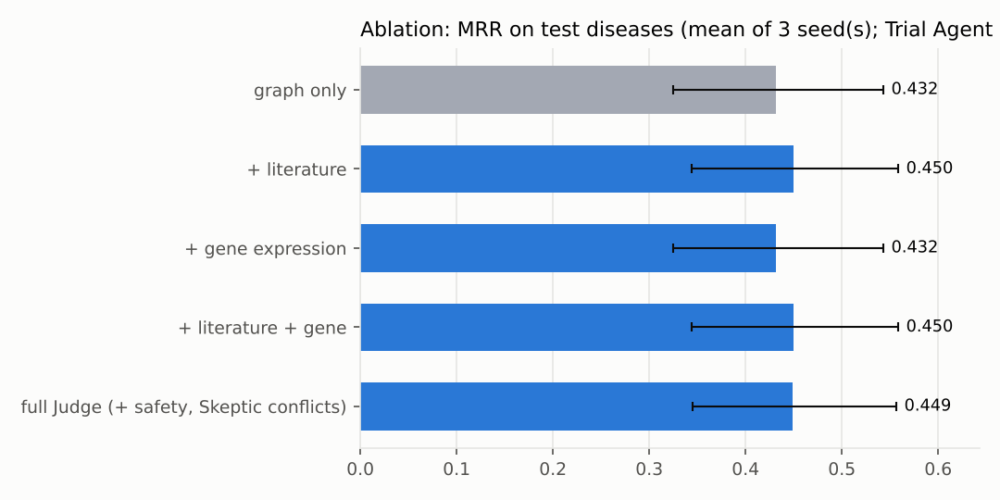
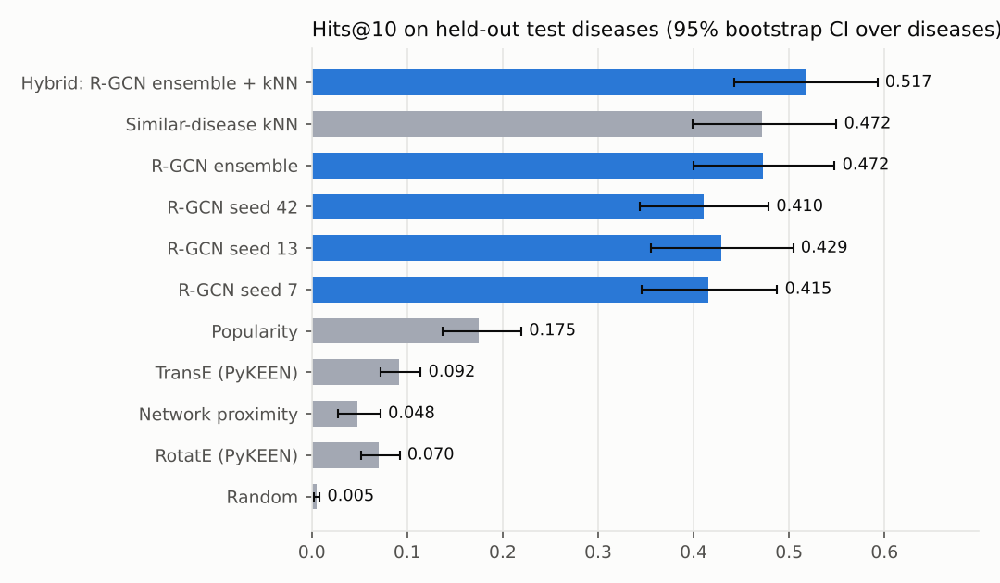
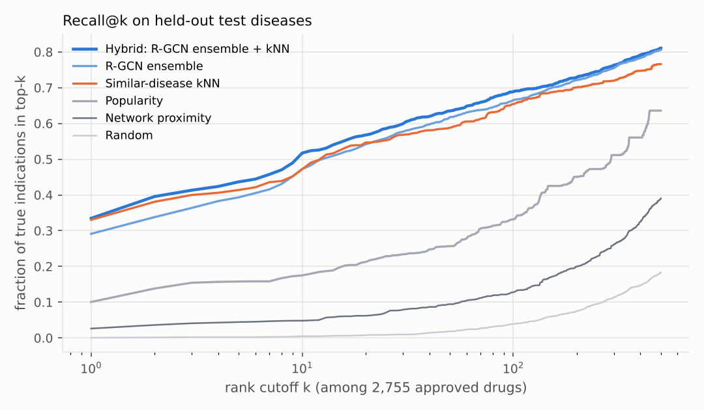
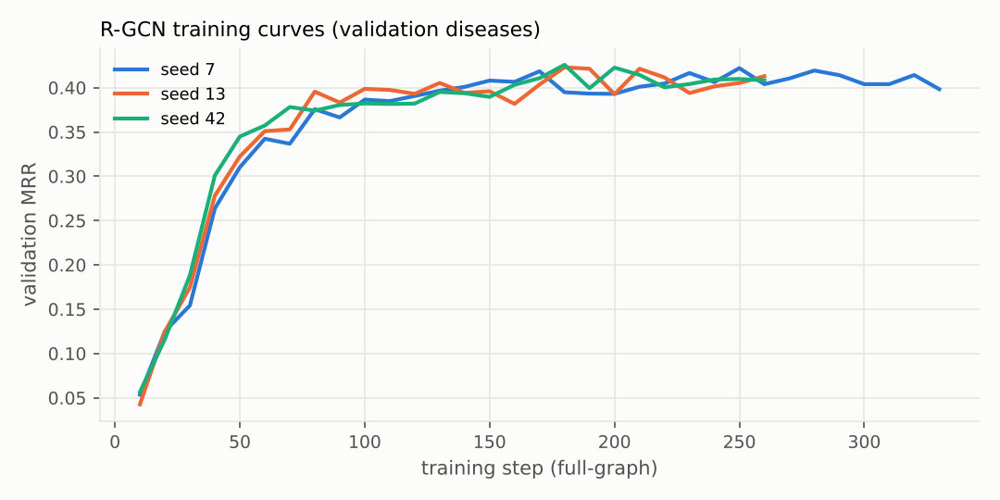
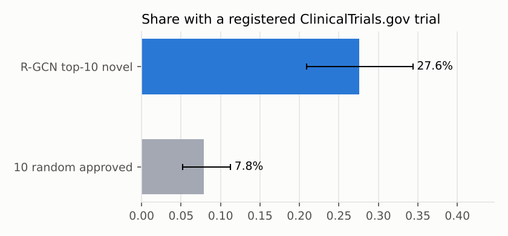

# Validation report

All numbers below were measured by the project's own pipeline. Nothing is copied from papers.

## 1. Disease-held-out link prediction (zero-shot)

Test set: 2098 drug–disease pairs (indication + off-label) over 229 held-out diseases. Each true drug is ranked among 2,755 approved drugs, with the disease's other true drugs filtered out. A labelled disease within two MONDO hops of a test disease is also held out (no parent, child or sibling leakage). Brackets: 95% bootstrap CI, resampling diseases.

| Model | MRR | Hits@1 | Hits@10 | Hits@50 | Median rank | AUROC |
|---|---|---|---|---|---|---|
| Random | 0.004 [0.002–0.005] | 0.000 | 0.005 [0.002–0.008] | 0.019 | 1400 | 0.499 |
| Popularity (drug degree) | 0.135 [0.104–0.168] | 0.101 | 0.175 [0.137–0.220] | 0.256 | 291 | 0.830 |
| Network proximity (PPI) | 0.038 [0.022–0.057] | 0.026 | 0.048 [0.027–0.072] | 0.094 | 748 | 0.668 |
| Similar-disease kNN | 0.381 [0.310–0.457] | 0.330 | 0.472 [0.399–0.550] | 0.588 | 13 | 0.887 |
| TransE (PyKEEN, 25 ep.) | 0.051 [0.039–0.064] | 0.027 | 0.092 [0.072–0.114] | 0.211 | 379 | 0.785 |
| RotatE (PyKEEN, 25 ep.) | 0.031 [0.024–0.041] | 0.008 | 0.070 [0.052–0.092] | 0.215 | 304 | 0.799 |
| R-GCN episodic, seed 7 | 0.290 [0.229–0.356] | 0.230 | 0.415 [0.345–0.488] | 0.555 | 29 | 0.883 |
| R-GCN episodic, seed 13 | 0.292 [0.229–0.358] | 0.231 | 0.429 [0.355–0.504] | 0.568 | 20 | 0.870 |
| R-GCN episodic, seed 42 | 0.292 [0.237–0.358] | 0.235 | 0.410 [0.344–0.479] | 0.549 | 28 | 0.888 |
| R-GCN episodic, 3-seed ensemble | 0.349 [0.284–0.418] | 0.291 | 0.472 [0.400–0.548] | 0.617 | 13 | 0.898 |
| **Hybrid Graph Scout: R-GCN ensemble + kNN (deployed)** | 0.393 [0.323–0.467] | 0.335 | 0.517 [0.443–0.593] | 0.635 | 10 | 0.901 |

R-GCN mean over 3 seeds: MRR 0.292 ± 0.001 (sd), Hits@10 0.418 ± 0.008.

**Design iteration (reported for transparency).** A first version excluded *all* drug–disease edges from message passing. On the same test set it reached MRR 0.298, 0.289, 0.262 (seeds 7/13/42; ensemble 0.338), below the similar-disease kNN baseline. The final model uses TxGNN-style episodic training: training diseases outside the current supervision episode keep their drug edges in the message-passing graph; held-out diseases never have any.

## 2. Rediscovery of known repurposings

The disease is held out from training entirely. Baricitinib → COVID-19 is **not an edge in PrimeKG**, so it is a prospective test. Ranks are among approved drugs (lower is better).

| Drug → disease | Model | Disease features | Rank |
|---|---|---|---|
| Sildenafil → erectile dysfunction (disease) | held-out ensemble + kNN | PrimeKG graph only | **2** / 2745 |
| Thalidomide → plasma cell myeloma | held-out ensemble + kNN | PrimeKG graph only | **333** / 2731 |
| Minoxidil → alopecia | held-out ensemble + kNN | PrimeKG graph only | **1173** / 2755 |
| Baricitinib → COVID-19 | held-out ensemble + kNN | PrimeKG graph only | **282** / 2755 |
| Sildenafil → erectile dysfunction (disease) | production ensemble + kNN | PrimeKG graph only | **3** / 2745 |
| Thalidomide → plasma cell myeloma | production ensemble + kNN | PrimeKG graph only | **1147** / 2731 |
| Minoxidil → alopecia | production ensemble + kNN | PrimeKG graph only | **1379** / 2755 |
| Baricitinib → COVID-19 | production ensemble + kNN | PrimeKG graph only | **265** / 2755 |
| Sildenafil → erectile dysfunction (disease) | split_s13 | PrimeKG graph only | **60** / 2745 |
| Thalidomide → plasma cell myeloma | split_s13 | PrimeKG graph only | **635** / 2731 |
| Minoxidil → alopecia | split_s13 | PrimeKG graph only | **1896** / 2755 |
| Baricitinib → COVID-19 | split_s13 | PrimeKG graph only | **166** / 2755 |
| Sildenafil → erectile dysfunction (disease) | split_s13 | PrimeKG + 27 Open Targets genes (genetics/expression/pathways/animal models; no drug or literature evidence) | **502** / 2745 |
| Thalidomide → plasma cell myeloma | split_s13 | PrimeKG + 100 Open Targets genes (genetics/expression/pathways/animal models; no drug or literature evidence) | **571** / 2731 |
| Minoxidil → alopecia | split_s13 | PrimeKG + 98 Open Targets genes (genetics/expression/pathways/animal models; no drug or literature evidence) | **1595** / 2755 |
| Baricitinib → COVID-19 | split_s13 | PrimeKG + 100 Open Targets genes (genetics/expression/pathways/animal models; no drug or literature evidence) | **275** / 2755 |
| Sildenafil → erectile dysfunction (disease) | split_s42 | PrimeKG graph only | **17** / 2745 |
| Thalidomide → plasma cell myeloma | split_s42 | PrimeKG graph only | **569** / 2731 |
| Minoxidil → alopecia | split_s42 | PrimeKG graph only | **562** / 2755 |
| Baricitinib → COVID-19 | split_s42 | PrimeKG graph only | **300** / 2755 |
| Sildenafil → erectile dysfunction (disease) | split_s42 | PrimeKG + 27 Open Targets genes (genetics/expression/pathways/animal models; no drug or literature evidence) | **149** / 2745 |
| Thalidomide → plasma cell myeloma | split_s42 | PrimeKG + 100 Open Targets genes (genetics/expression/pathways/animal models; no drug or literature evidence) | **725** / 2731 |
| Minoxidil → alopecia | split_s42 | PrimeKG + 98 Open Targets genes (genetics/expression/pathways/animal models; no drug or literature evidence) | **665** / 2755 |
| Baricitinib → COVID-19 | split_s42 | PrimeKG + 100 Open Targets genes (genetics/expression/pathways/animal models; no drug or literature evidence) | **540** / 2755 |
| Sildenafil → erectile dysfunction (disease) | split_s7 | PrimeKG graph only | **1** / 2745 |
| Thalidomide → plasma cell myeloma | split_s7 | PrimeKG graph only | **119** / 2731 |
| Minoxidil → alopecia | split_s7 | PrimeKG graph only | **1134** / 2755 |
| Baricitinib → COVID-19 | split_s7 | PrimeKG graph only | **310** / 2755 |
| Sildenafil → erectile dysfunction (disease) | split_s7 | PrimeKG + 27 Open Targets genes (genetics/expression/pathways/animal models; no drug or literature evidence) | **2** / 2745 |
| Thalidomide → plasma cell myeloma | split_s7 | PrimeKG + 100 Open Targets genes (genetics/expression/pathways/animal models; no drug or literature evidence) | **214** / 2731 |
| Minoxidil → alopecia | split_s7 | PrimeKG + 98 Open Targets genes (genetics/expression/pathways/animal models; no drug or literature evidence) | **560** / 2755 |
| Baricitinib → COVID-19 | split_s7 | PrimeKG + 100 Open Targets genes (genetics/expression/pathways/animal models; no drug or literature evidence) | **1404** / 2755 |

## 3. Ablation of evidence agents

Top-20 graph candidates of 80 randomly chosen test diseases are re-ranked; true drugs outside the top-20 keep their graph rank. The Trial Agent is off. Judge weights were fitted on 80 validation diseases: `{"G": 1.3511, "L": 0.6932, "E": 0.0, "D": 0.4}`, λs = 0.4242, λc = 0.4074.

| Variant | MRR (seed 7) | MRR (seed 13) | MRR (seed 42) | Hits@1 (mean) | Hits@10 (mean) |
|---|---|---|---|---|---|
| graph only | 0.418 [0.314–0.530] | 0.428 [0.317–0.544] | 0.449 [0.345–0.555] | 0.363 | 0.580 |
| + literature | 0.449 [0.344–0.556] | 0.437 [0.327–0.548] | 0.466 [0.362–0.572] | 0.382 | 0.587 |
| + gene expression | 0.418 [0.314–0.530] | 0.428 [0.317–0.544] | 0.449 [0.345–0.555] | 0.363 | 0.580 |
| + literature + gene | 0.449 [0.344–0.556] | 0.437 [0.327–0.548] | 0.466 [0.362–0.572] | 0.382 | 0.587 |
| full Judge (+ safety, Skeptic conflicts) | 0.441 [0.337–0.548] | 0.439 [0.332–0.548] | 0.468 [0.365–0.574] | 0.380 | 0.586 |

Coverage: 48% of candidate pairs have ≥1 co-mentioning PubMed abstract; 0.3% have L1000 evidence (11 of 80 diseases have a GEO signature). Docking is not part of the ablation (≈20 Vina runs per disease are too costly at this scale); it is run per disease in the app.

**Leakage warning.** Literature co-mention rediscovers what is already published. Known indications are, by construction, heavily published, so the literature channel inflates validation metrics. It is reported separately here, and in the app it is one channel among several.

## 4. Trial cross-check

Top-10 NOVEL graph predictions (PrimeKG indications removed) for held-out test diseases vs 10 random approved drugs; a registered trial (any phase/status) matching the condition and intervention counts as a hit.

| Set | Share with a registered trial | 95% CI | pairs |
|---|---|---|---|
| R-GCN top-10 novel | 27.6% | 20.9%–34.4% | 710 |
| 10 random approved | 7.8% | 5.2%–11.3% | 790 |

## 5. Rare diseases and data poverty

Deployed hybrid Graph Scout on the same test pairs, grouped by disease.

| Group | diseases | pairs | MRR | Hits@10 |
|---|---|---|---|---|
| rare (Orphanet) | 100 | 776 | 0.422 [0.304–0.537] | 0.515 [0.387–0.636] |
| common / not in Orphanet | 129 | 1322 | 0.376 [0.286–0.467] | 0.518 [0.419–0.612] |
| ≤ 10 disease genes in graph | 136 | 763 | 0.356 [0.261–0.459] | 0.503 [0.395–0.615] |
| > 10 disease genes in graph | 93 | 1335 | 0.414 [0.322–0.517] | 0.525 [0.425–0.634] |

## 6. What this does not show

- PrimeKG has no timestamps, so a strict time-split is not possible; the disease-held-out split with ontology-neighbour removal is used instead.
- Related diseases that are *not* MONDO neighbours (e.g. psoriasis vs psoriatic arthritis) can still sit on opposite sides of the split.
- PrimeKG indications are incomplete: a top-ranked drug that is not a recorded indication is not necessarily wrong.
- Docking with rigid receptors and Vina scores are coarse; decoy z-scores are only a sanity filter.
- The precomputed rare-disease atlas uses the graph scout only; the full agent pipeline runs per disease in the app.
- Nothing here is clinical evidence.

## Figures

